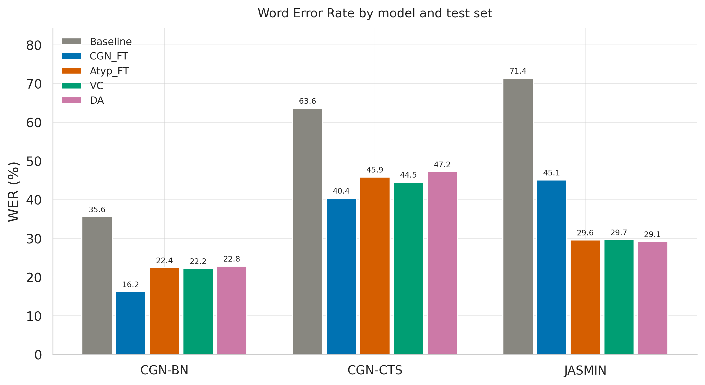

# Reproduction Package — Mitigating ASR Bias in Non-Native Dutch Speech

**Course:** Inclusive Speech Technology (DSAIT4095), TU Delft, 2026  
**Author:** Maksym Ziemlewski

---
This package accompanies a study investigating fine-tuning strategies and data augmentation for improving Dutch non-native automatic speech recognition with Whisper-small and LoRA. Five model configurations are compared: a zero-shot baseline, fine-tuning on native Dutch speech (CGN), fine-tuning on non-native speech (JASMIN-CGN), voice conversion augmentation (Seed-VC), and on-the-fly augmentation with speed perturbation and SpecAugment.

**Key result:** fine-tuning on non-native speech cut WER on JASMIN from 71.4% (zero-shot) to ~29%, and shrank the native vs. non-native gap from 35.8 to 6–7 percentage points.

## Contents

- `hparams/` — YAML configuration files for all five models
- `jobs/` — SLURM batch scripts
- `figures/` — generated result figures
- `cgn_prepare_f.py` — CGN data preparation
- `jasmin_prepare_f.py` — JASMIN non-native data preparation
- `vc_prep.py`, `vc_csv_builder.py` — voice conversion augmentation pipeline
- `train_with_whisper.py` — training and evaluation
- `parse_and_plot_all.py` — result parsing and figure generation
- `parse_wer_per_speaker.py` — per-speaker WER extraction
- `dataset_stats.py` — dataset statistics

The CGN and JASMIN-CGN corpora are licensed and not included; paths in the configs point to the original cluster setup.
